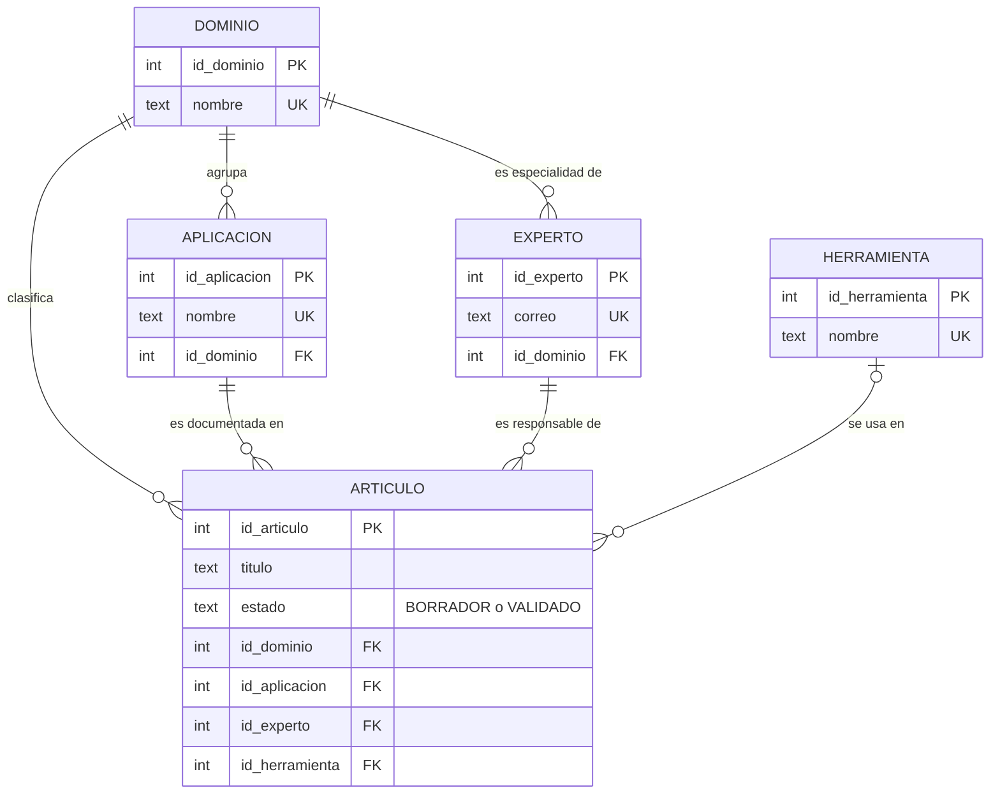

## Semana 15 – Ingeniería del conocimiento: base de conocimiento empresarial (SQLite)

Base de conocimiento **organizada** del Asistente de Soporte TI Híbrido. Reúne en una base de datos SQLite los **dominios** del proyecto, sus **aplicaciones** (módulos), los **expertos** responsables, las **herramientas** de desarrollo y los **artículos** o procedimientos. Cada artículo nace como **BORRADOR**, se **valida** y solo entonces es **visible** en las consultas habituales.

---
   ### Enlace al repositorio
   - Daniel Daza: [asistente_soporte_TI_hibrido](https://github.com/DanielDaza2901/asistente_soporte_TI_hibrido)
   - Marco Molina: [asistente_soporte_TI_hibrido](https://github.com/MarcoMolina2011/asistente_soporte_TI_hibrido)
---
### Archivos de la semana

| Archivo | Para qué sirve |
|---|---|
| `sql/esquema.sql` | Crea las 5 tablas con claves primarias, claves foráneas, restricciones `CHECK` y 3 disparadores |
| `sql/datos.sql` | Carga datos ficticios que corresponden a los módulos reales del proyecto |
| `src/base_conocimiento.py` | Módulo Python: registrar, validar y consultar artículos, y la demostración completa |
| `tests/test_base_conocimiento.py` | 31 pruebas con `unittest` (las 5 obligatorias están en una clase propia) |
| `src/main.py` | Sección 13: ejecuta la demostración dentro del pipeline completo |

### Paso 1. Modelar el conocimiento del proyecto

| Elemento | En este proyecto | Cantidad |
|---|---|---|
| **Dominio** | Áreas temáticas: Taxonomía y priorización, Recuperación de información, Razonamiento simbólico, Aprendizaje automático, Visión artificial, Planificación y decisión, Auditoría y plataforma | 7 |
| **Aplicación** | Módulos del repositorio (por ejemplo, Motor de inferencia lógica → `src/classifiers/motor_inferencia.py`) | 11 |
| **Experto** | Responsables ficticios, cada uno con un dominio de especialidad | 7 |
| **Herramienta** | Python, SQLite, scikit-learn, scikit-image, NetworkX, Streamlit, unittest, Git y GitHub | 8 |
| **Artículo** | Procedimientos sobre cómo funciona cada módulo, con su fuente en el código | 12 |

Relaciones: una aplicación pertenece a un dominio; un experto tiene un dominio de especialidad; un artículo se clasifica en un dominio, documenta una aplicación, tiene un experto responsable y, opcionalmente, usa una herramienta.



### Paso 2. Integridad de datos

| Regla | Dónde se garantiza |
|---|---|
| Claves primarias autoincrementales en las 5 tablas | `PRIMARY KEY AUTOINCREMENT` |
| Referencias a dominios, aplicaciones, expertos y herramientas que existen | Claves foráneas (`ON DELETE RESTRICT`: no se puede borrar un registro en uso) |
| Nombres y correos únicos; un mismo título no se repite en una aplicación | `UNIQUE` |
| Estado solo `BORRADOR` o `VALIDADO`; textos con longitud mínima; correo con formato; tipo de herramienta de una lista | `CHECK` |
| Un artículo `VALIDADO` siempre tiene fecha de validación y un `BORRADOR` nunca | `CHECK` combinado |
| **Todo artículo nuevo nace como BORRADOR** | Disparador `trg_articulo_inicia_borrador` y el código Python, que nunca asigna `VALIDADO` al registrar |
| La aplicación del artículo pertenece a su dominio | Disparador `trg_articulo_coherencia_dominio` y validación en Python |
| Un `VALIDADO` no vuelve a `BORRADOR` | Disparador `trg_articulo_sin_retroceso` |

Las reglas están en **dos niveles**: el módulo Python da mensajes claros (`ReferenciaInexistenteError`, `DatosInvalidosError`, `EstadoInvalidoError`) y la base de datos las vuelve a exigir aunque alguien escriba SQL directamente. SQLite no aplica las claves foráneas por defecto, por eso cada conexión ejecuta `PRAGMA foreign_keys = ON`.

### Paso 3. Funciones del módulo `base_conocimiento.py`

| Función | Qué hace |
|---|---|
| `crear_esquema(con_datos, reiniciar)` | Ejecuta `esquema.sql` y, si se pide, `datos.sql` |
| `registrar_articulo(...)` | Registra un artículo y lo deja siempre en **BORRADOR** |
| `validar_articulo(id)` | Pasa a **VALIDADO** y registra la fecha de validación |
| `consultar_por_dominio(dominio)` | Artículos de un dominio (por id o nombre); **solo VALIDADO** por defecto |
| `listar_publicados()` | Todos los artículos VALIDADO |
| `listar_borradores()` | Cola de artículos pendientes de validar |
| `buscar_publicados(texto)` | Busca en título y contenido, solo entre los VALIDADO |
| `contar_por_dominio()` | Validados y borradores por dominio (`JOIN` con agregación) |
| `ejecutar_demostracion()` | Recorre el flujo exigido en la sustentación |

Las consultas relacionan cuatro tablas con `SQL JOIN`:

```sql
SELECT a.titulo, d.nombre AS dominio, ap.nombre AS aplicacion, e.nombre AS experto, h.nombre AS herramienta
  FROM articulo a
  JOIN dominio d          ON d.id_dominio = a.id_dominio
  JOIN aplicacion ap      ON ap.id_aplicacion = a.id_aplicacion
  JOIN experto e          ON e.id_experto = a.id_experto
  LEFT JOIN herramienta h ON h.id_herramienta = a.id_herramienta
 WHERE a.estado = 'VALIDADO' AND d.nombre = 'Razonamiento simbólico';
```

### Paso 4. Cómo ejecutarlo

Desde la raíz del proyecto, con el entorno virtual activado:

```powershell
python src/base_conocimiento.py                          # demostración de la Semana 15
python src/main.py                                       # pipeline completo (sección 13 = Semana 15)
python -m unittest discover -s tests -v                  # todas las pruebas del proyecto
python -m unittest tests.test_base_conocimiento -v       # solo las de esta semana
```

La base se genera en `artifacts/base_conocimiento.db` y se reconstruye cada vez que se ejecuta la demostración, así el resultado es siempre reproducible. El módulo usa solo la biblioteca estándar (`sqlite3`): no añade dependencias.

### Paso 5. Evidencias

**Demostración (`python src/base_conocimiento.py`):**

```text
[1] Base creada con sql/esquema.sql y sql/datos.sql  (OK)
    Tablas: dominio=7, aplicacion=11, experto=7, herramienta=8, articulo=12
    Artículos de ejemplo: 9 VALIDADO y 3 BORRADOR
[2] Registrar un artículo nuevo  (OK)
    Título: Registro de oraciones en la red semántica
    Dominio: Razonamiento simbólico | Aplicación: Red semántica de soporte TI
    Experto: Carlos Rojas | Fuente: src/classifiers/red_semantica.py
    Estado inicial: BORRADOR
[3] Consulta habitual por dominio (solo VALIDADO): el borrador NO aparece  (OK)
    Artículos visibles en «Razonamiento simbólico»: 2
    ¿Aparece el borrador «Registro de oraciones en la red semántica»? NO
[4] Validar el artículo  (OK)
    Estado actual: VALIDADO (validado el 2026-11-15 14:38:08)
[5] Consulta por dominio después de validar: el artículo SÍ aparece  (OK)
    Artículos visibles en «Razonamiento simbólico»: 3
    ¿Aparece «Registro de oraciones en la red semántica»? SÍ
[6] Consulta con SQL JOIN (artículo + dominio + aplicación + experto + herramienta)  (OK)
    Registro de oraciones en la red semántica | Razonamiento simbólico | Red semántica de soporte TI | Carlos Rojas | Python
[7] Integridad: referencias inexistentes y estado inicial  (OK)
    Dominio inexistente: rechazado -> No existe el dominio con id 9999.
    Experto inexistente: rechazado -> No existe el experto con id 9999.
    INSERT directo como VALIDADO: rechazado por la base de datos -> Un articulo nuevo debe registrarse como BORRADOR
```

**Pruebas (`python -m unittest tests.test_base_conocimiento`):** 31 pruebas, resultado `OK`.

| Clase | Pruebas | Qué verifica |
|---|---|---|
| `TestCincoPruebasObligatorias` | 5 | Registro en BORRADOR, borrador oculto, validación que publica, dominio inexistente y experto inexistente |
| `TestEsquemaYDatos` | 3 | Las 5 tablas, los datos de ejemplo y que no haya violaciones de claves foráneas |
| `TestRegistroYValidacion` | 9 | Aplicación o herramienta inexistente, dominio incoherente, duplicados, textos inválidos, validar dos veces |
| `TestConsultas` | 7 | Consulta por id y nombre, `JOIN`, solo VALIDADO, borradores ocultos hasta validarse |
| `TestIntegridadEnLaBaseDeDatos` | 6 | Ataques directos con SQL: estado inválido, clave foránea, `DELETE` de un dominio en uso, correo |
| `TestDemostracion` | 1 | La demostración completa termina sin fallos |


### Limitaciones

- La base está pensada para un solo usuario: no hay autenticación ni control de quién valida.
- Quien valida no se registra; solo se guarda la fecha de validación.
- Los datos son ficticios y las descripciones resumen el funcionamiento de los módulos del proyecto.